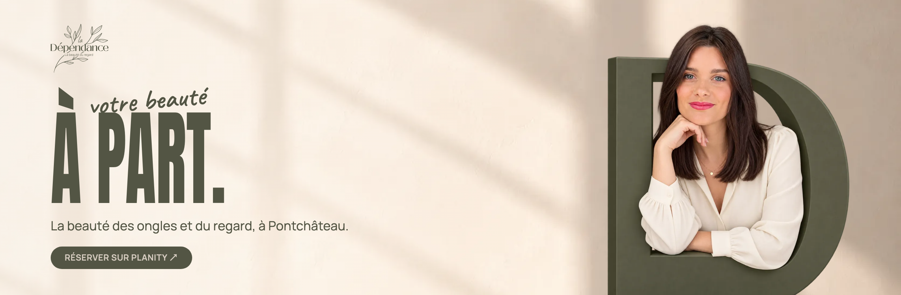
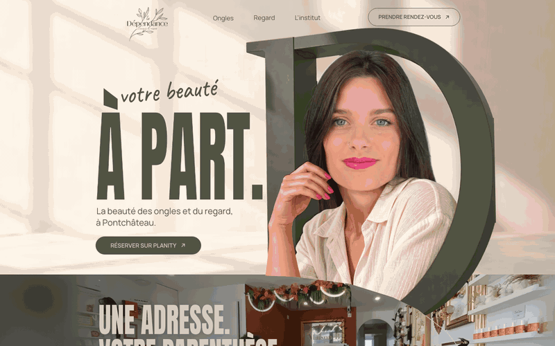
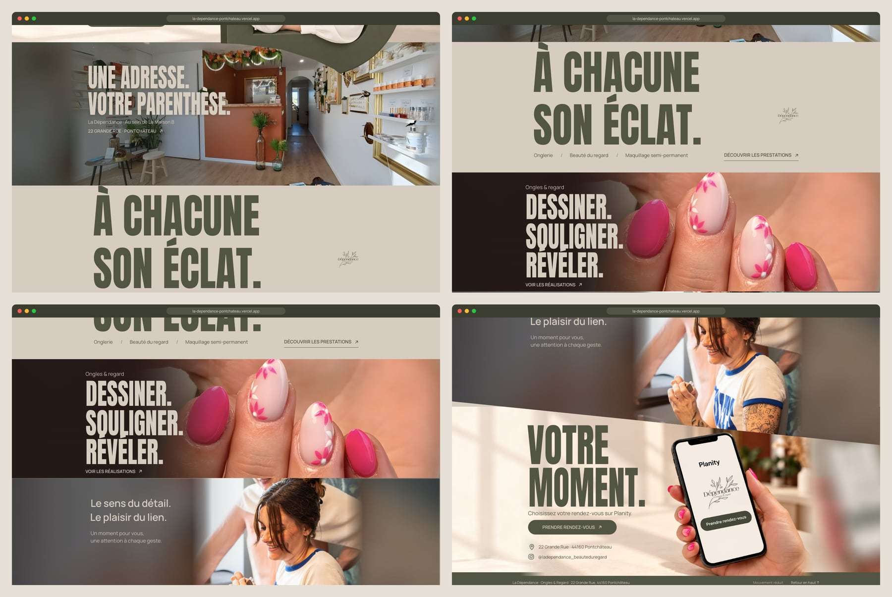
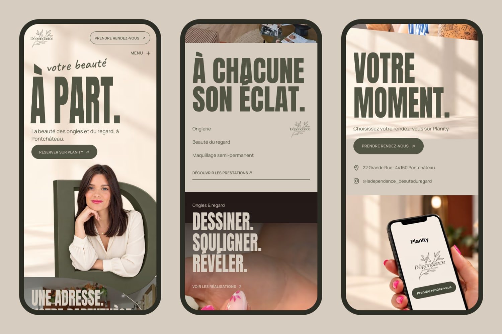
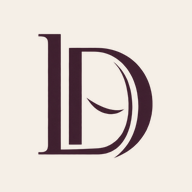

<div align="center">



<h3>A one-page website for a nail and brow studio in Pontchâteau, built around one scroll gesture: the studio opens through the D of its own logo.</h3>

<p>
  <a href="https://la-dependance-pontchateau.vercel.app"><strong>🌐 Live site</strong></a>
  &nbsp;·&nbsp;
  <a href="#hero-animation"><strong>🎬 How the hero works</strong></a>
  &nbsp;·&nbsp;
  <a href="#getting-started"><strong>🛠️ Run it locally</strong></a>
</p>

<p>
  <a href="https://la-dependance-pontchateau.vercel.app"></a>
  
  
  
  
</p>

</div>

<br />

## 🚀 Overview

**La Dépendance** is a nail and brow studio (onglerie, beauté du regard, maquillage semi-permanent) inside **La Maison B**, 22 Grande Rue in Pontchâteau. The client chose model 3 of the design kit, **« À PART. / Le Passage »**: the owner framed by a giant olive D, the real studio behind it, one beige pause, the real nail work, the real team and booking on Planity. On 2026-10-28 the identity moved to the official olive and beige palette and the owner's logo, with the layout and every animation unchanged.

The page reproduces that approved board pixel for pixel on desktop, then animates it: as you scroll, the hero stays put while the real interior **rises over it**, the D and the portrait glide out of frame and the arc of the D cuts them away. Each later scene gets its own motion, and every booking button leads to the studio's Planity page.

- **Board-exact desktop**: every photo is placed where SIFT registration found it on the approved board, every line of type is fitted to the board's ink box
- **Real place, real work**: the interior, the nail art and the team are the studio's own photos, cleaned of capture UI and upscaled, never replaced by generated images
- **Booking first**: 9 Planity links, a services panel with three tabs, a gallery of four pieces; no invented phone, prices, hours or reviews
- **Light**: 374 KB on the first desktop load (404 KB after scrolling the whole page), 244 KB on a phone

<br />

<a name="hero-animation"></a>

## 🎬 The hero animation

<div align="center">
  <a href="https://la-dependance-pontchateau.vercel.app"></a>
  <sub>Scroll-scrubbed on the live site · captured at 1440 × 900</sub>
</div>

<br />

The hero is pinned for exactly its own height (508 board px, 0.79 of a 1440 × 900 screen) while the interior slides up over it:

| Scroll   | What happens                                                                                     |
| :------- | :----------------------------------------------------------------------------------------------- |
| on load  | 1.25 s intro: letters of **À PART.** rise one by one, *votre beauté* is written in, the portrait settles |
| 0–30%    | The interior climbs over the studio wall; the lead line and **Réserver sur Planity** step back     |
| 12–60%   | The title slides left and fades with the header; the mini header with **Prendre rendez-vous** takes over |
| 42–100%  | The D and the portrait glide right (up to 32 vw) and grow 4.5 %, cut from below by the rising arc |
| 100%     | The interior sits exactly where the approved board puts it: *Une adresse. Votre parenthèse.*      |

**Under the hood**

- 🧩 **Two sticky layers, one runway.** The stage (studio wall, words, header) and the foreground (D + portrait) are sibling sticky layers in a runway twice the hero's height; the next section has a negative margin of one hero, so the page below keeps its normal position and simply covers the hero.
- 🌙 **The arc is a clip path that rides the interior.** The foreground's visible region is the area above the board's arc; every frame lifts it by the distance the interior has risen, so the D is always cut exactly at the interior's edge. The thin beige line over the shelves is the same curve.
- 📐 **Measured, not guessed.** Plates were registered on the approved board with SIFT + RANSAC (`scripts/register-board.py`), type sizes and horizontal scales were fitted to the board's ink boxes (`scripts/fit-type.py`), and `npm run compare` renders the page next to the board with a 50 % blend.
- 🐢 **Graceful by default.** With reduced motion, data saver, `?static` or the footer's **Mettre en pause** button, the runway and every scroll effect are removed and the page is the static board. Without JavaScript all copy, links and photos are still there.

<br />

## 🖥️ Sections

<div align="center">
  
</div>

<br />

| #   | Section                                   | Anchor          | Role and motion                                                                                   |
| :-- | :---------------------------------------- | :-------------- | :------------------------------------------------------------------------------------------------ |
| 01  | **votre beauté À PART.**                  | `#accueil`      | Campaign portrait in the D, first booking button; intro + the passage above                       |
| 02  | **Une adresse. Votre parenthèse.**        | `#lieu`         | The real interior of La Maison B; lines rise out of a mask, photo parallax                         |
| 03  | **À chacune son éclat.**                  | `#prestations`  | The one solid scene, beige; 17 letters rise in scroll order, the logo seal turns in; each service opens the panel |
| 04  | **Dessiner. Souligner. Révéler.**         | `#creations`    | Real fuchsia nail art; the photo wipes in, *Dessiner* is drawn, *Souligner* gets an underline sweep, *Révéler* comes out of a blur; gallery of four |
| 05  | **Le sens du détail. Le plaisir du lien.** | `#equipe`       | The real team photo; curtain reveal and a word-by-word reading scrub                              |
| 06  | **Votre moment.**                         | `#rendez-vous`  | Phone scene rising across the team's diagonal edge, Planity button, address and Instagram         |

<br />

## 📱 Mobile first, motion optional

<div align="center">
  
</div>

<br />

- Own phone layout (a 390 px design that scales with the width): title on top, the D and the portrait below, cut by the same arc
- Same passage, shorter runway; the header keeps **Prendre rendez-vous** and a **Menu** disclosure
- Large touch targets for booking, menu and services; no horizontal scroll at 360 or 390 px; text never under 11 px
- Nothing depends on hover

<br />

## ✨ Highlights

- **🎞️ Scroll storytelling**: one rAF render per scroll event (no loop while the page is still) and Lenis for the wheel, with a different technique in every scene
- **💅 Services panel**: native `<dialog>` with ARIA tabs (arrows, Home, End), Escape and click outside close it, focus returns to the link that opened it
- **🖼️ Gallery**: four real pieces with captions, previous/next and arrow keys
- **🧼 Real photos, cleaned**: the carousel buttons of the interior capture are un-blended and inpainted, capture headers and icons are cropped away, then Real-ESRGAN x4 (`npm run prepare-images`)
- **📦 Image pipeline**: AVIF + WebP at the widths each plate is shown at (`npm run images`); fonts subset to Latin + French WOFF2 (`npm run fonts`)
- **✅ QA script**: `npm run qa` checks overflow at five widths, scale, links, dialogs by keyboard, the passage states, no-JS, reduced motion, production words and that the kit is not deployed
- **🔎 Ready to share**: Open Graph image, `BeautySalon` structured data, favicons; `noindex` until the final domain

<br />

## 💻 Tech stack

| <br />Vite 6 | <br />JavaScript | <br />HTML5 | <br />CSS3 | <br />Python | <br />OpenCV | <br />Vercel |
| :---: | :---: | :---: | :---: | :---: | :---: | :---: |

### Why this stack?

- **Vite + plain JavaScript**: a one-page site needs no framework runtime; the markup is rendered at build time from `src/page.js` and the data files, so the HTML is complete without JavaScript
- **Own scroll engine + Lenis**: every scene owns its inline styles, driven by section progress; Lenis only smooths the wheel and stops when the page is still
- **Python + OpenCV for the art**: board registration, type fitting, UI removal, GrabCut for the phone cut-out and Real-ESRGAN run once, offline; the site only ships their results
- **Self-hosted Anton, Manrope and Caveat**: the kit's OFL fonts, subset to 89 KB in total
- **Vercel**: every push to `main` deploys automatically

<br />

## 🎨 Design system

| Token         | Value                                                                          | Use                                          |
| :------------ | :----------------------------------------------------------------------------- | :------------------------------------------- |
| Olive         |    | Type, buttons, the D, logo, footer, *votre beauté* |
| Beige         |    | Page, services scene, type on photos, the arc |

The two colours come from the owner's official chart (2026-10-28). The CSS keeps the approved token names (`--prune` and `--mauve` now hold the olive, `--ivory` and `--rose` the beige), so no rule or animation changed; the mapping is in `identite/migracao-cores.json`.

- **Type**: Anton condensed per line to the board (scaleX 0.60 for **À PART.**, 0.74–0.88 elsewhere), Manrope for text and navigation, Caveat 500 for the handwritten accent
- **Scale**: desktop draws the 734 px board at the density of a 1024 px board, `--u = min(100cqw, 1600px) / 1024`, centred, with photos and colour bleeding to the edges; small text floored at 11 px
- **Phones**: `--mu = 100cqw / 390`
- **Motion**: masks and clip paths rather than fades, `cubic-bezier(.2, .7, .2, 1)`, no image scaled more than 3 % beyond the board

<br />

<a name="getting-started"></a>

## 🛠️ Getting started

```bash
# Clone the repository
git clone https://github.com/Jeanfr1/La-Dependance-Website.git
cd La-Dependance-Website

# Install dependencies (Node 20.10+)
npm install

# Start the dev server  →  http://localhost:4356
npm run dev

# Production build  →  dist/
npm run build

# Preview the production build  →  http://localhost:4357
npm run preview

# Checks against the preview (or the live site with QA_BASE=...)
npm run qa
npm run compare        # page vs approved board → qa/board-compare.png

# Art pipeline (Anaconda Python with OpenCV + torch, Real-ESRGAN weights in ~/.cache/realesrgan)
npm run prepare-images # clean the real photos, upscale, phone cut-out
npm run images         # AVIF + WebP → public/img (bump V in the script when a plate changes)
npm run fonts          # subset WOFF2 → src/fonts
```

Capture flags: `?nosmooth` (no Lenis), `?static` (no motion, no pin).

<br />

## 📁 Project structure

```
La-Dependance-Website/
├── index.html                  # Head, meta, structured data; the body is rendered from src/page.js
├── vite.config.js              # Injects the page markup at build time
├── src/
│   ├── page.js                 # All six scenes, dialogs and footer as markup
│   ├── main.js                 # Scroll engine, passage, intro, dialogs, motion toggle
│   ├── styles/main.css         # Board layout (desktop), phone layout, components
│   ├── data/
│   │   ├── site.js             # Facts and copy: booking, address, services, gallery
│   │   ├── board.js            # Measured board geometry: plates, arc, diagonal
│   │   └── images.json         # Generated image sizes
│   └── fonts/                  # Subset WOFF2 + OFL licences
├── public/                     # img/ (AVIF/WebP), og.jpg, favicons, robots.txt
├── scripts/                    # register-board, fit-type, clean-photos, prepare-images,
│                               # build-images, build-fonts, qa, compare-board, readme-assets
├── identite/                   # Owner identity (2026-10-28): portrait master, phone scene, logo, colour map
└── kit (not deployed)          # LEIA-ME-KIT.md, roteiros/, references/, brand/, images/,
                                # business-card/, docs/, motion/, fonts-print/, site/, tools/
```

<br />

## 🚀 Deployment

Hosted on **Vercel** and connected to this repository: every push to `main` ships to production.

**Live site:** [la-dependance-pontchateau.vercel.app](https://la-dependance-pontchateau.vercel.app)

| Setting          | Value                                                  |
| :--------------- | :----------------------------------------------------- |
| Framework        | Vite (pinned in `vercel.json`)                         |
| Build command    | `vite build`                                           |
| Output directory | `dist`                                                 |
| Kit folders      | excluded by `.vercelignore`                            |
| Indexing         | `noindex` (meta, `X-Robots-Tag`, `robots.txt`) until the final domain |

<br />

## 📌 Content checklist

Items waiting on the institute. Each one is marked `TODO(dependance)` in the code.

- [ ] Final domain (then update `canonical`, `og:url`, `og:image` and remove `noindex`)
- [ ] Mentions légales: business name, SIRET and host details for the footer
- [ ] Google listing link (`cid`) for the address; it opens an address search until then
- [ ] Confirm the service list and its wording (prices and availability stay on Planity)
- [x] The portrait in the D is the owner (2026-10-28): the plate from the identity package, at the approved plate's scale and moved 32 board px right so the D clears the period of « À PART. » (`identite/LEIA-ME.md`)
- [ ] Permission for the real photos taken from the institute's Google and Instagram pages

Choices made from the kit:

- The team photo is vertical, so it stays sharp on the right with a blurred extension of the same file around it (roteiro 01), instead of the board's widened version
- The nail art is the real photo, framed to the board's composition, not the board's re-rendered close-up
- Added to the board: the street address under *Une adresse.*, the second team line and **Voir les réalisations**, all from the kit's copy file

<br />

## 🙏 Acknowledgments

- **La Dépendance** and **La Maison B** for the brief, the photos and the approved model 3
- **[Anton](https://fonts.google.com/specimen/Anton)** by Vernon Adams, **[Manrope](https://fonts.google.com/specimen/Manrope)** by Mikhail Sharanda and **[Caveat](https://fonts.google.com/specimen/Caveat)** by Impallari Type (OFL)
- **[Lenis](https://github.com/darkroomengineering/lenis)** for smooth scrolling
- **[Real-ESRGAN](https://github.com/xinntao/Real-ESRGAN)** and **[OpenCV](https://github.com/opencv/opencv)** for the image work
- **[Vite](https://vite.dev)** and **[Vercel](https://vercel.com)**

<br />

---

<div align="center">
  
  <p><strong>Votre beauté, à part.</strong></p>
  <p>Built with ❤️ by <a href="https://github.com/Jeanfr1">Jean</a> for La Dépendance</p>
  <sub>© 2026 La Dépendance. All rights reserved.</sub>
</div>
